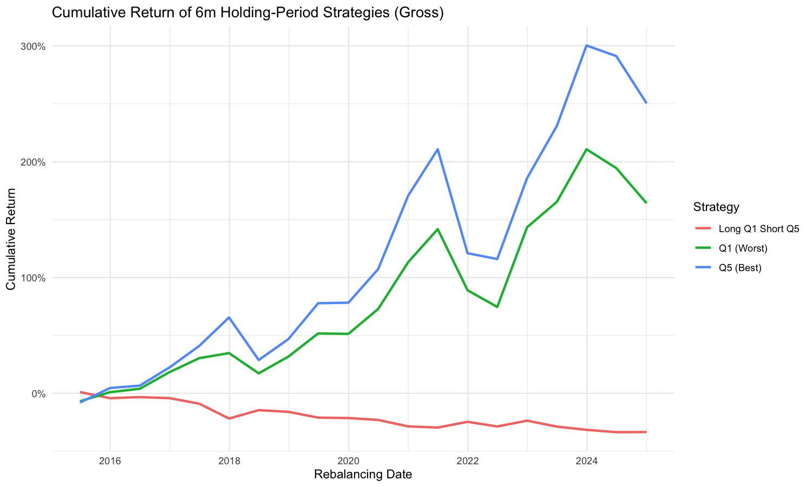

# Taiwan Mutual Fund Return Reversal Effect

A backtest of a short-term (3M/6M) reversal strategy on Taiwan equity mutual
funds: rank funds into quintiles by trailing return, go long the worst
quintile and short the best (Q1–Q5), and test whether recent laggards
outperform recent winners going forward. Includes transaction costs, a
crash-period / beta-hedge overlay against the TW50 index, a significance
test on the long-short return, and a survivorship-bias check.

**Result: they don't.** Across both holding periods, the best-performing
quintile (Q5) keeps outperforming the worst (Q1); the long-short reversal
leg is consistently negative but not statistically significant (p ≈
0.14–0.42). In this market and sample, short-term momentum dominates
reversal — see [`docs/research_report.md`](docs/research_report.md) for the
full write-up.



Full write-up (methodology, all results, limitations): **[`docs/research_report.md`](docs/research_report.md)**

## Methodology highlights

- Parametrized backtest engine — window length and rebalance frequency are
  arguments, shared by both the 3-month and 6-month specifications.
- Significance-tested long-short return (one-sample t-test), not just a
  point estimate.
- Transaction-cost-aware performance, with a sourced cost assumption and a
  0–2% cost-sensitivity table.
- Survivorship-bias check confirming delisted/merged funds' pre-exit
  history is retained in the data rather than excluded outright.
- Backtest engine only scores rebalance periods whose full holding window
  falls inside the observed sample, avoiding any look-ahead leakage.

## Data

Fund returns and the risk-free rate come from TEJ (Taiwan Economic Journal),
a licensed database — its terms don't allow redistributing the raw export,
so `data/raw/` is git-ignored (one exception: a small supplementary
risk-free-rate file hand-compiled from public Central Bank of Taiwan
statistics, which is tracked). See [`data/README.md`](data/README.md) for
the exact expected file format if you want to reproduce this with your own
TEJ access.

## Repository layout

```
R/                     reusable functions
  data_prep.R           parse the TEJ fund/rf exports into tidy tables;
                         fund_exit_diagnostic() checks survivorship-bias exposure
  backtest.R            quintile ranking + long-short backtest (parametrized
                         by window length and rebalance frequency)
  performance.R         annualized return/vol/Sharpe + significance test
  costs.R               transaction-cost overlay + cost-sensitivity table
  plotting.R            cumulative return chart
  hedge.R               crash-month detection + beta-hedge overlay
scripts/                entry points, run in order
  00_install_packages.R
  01_run_backtests.R     -> output/tables/perf_table_{3m,6m}[_net].csv,
                            cost_sensitivity_{3m,6m}.csv, fund_coverage_by_year.csv,
                            fund_exit_diagnostic.csv, output/figures/*.png
  02_crash_hedge_analysis.R -> output/tables/crash_hedge_comparison.csv
data/                   data/README.md documents the required raw inputs
output/                 generated tables and charts (checked in; regenerate
                         with the scripts above)
docs/research_report.md full research write-up
```

## Running it

```r
Rscript scripts/00_install_packages.R
Rscript scripts/01_run_backtests.R
Rscript scripts/02_crash_hedge_analysis.R
```

Requires R and the packages listed in `scripts/00_install_packages.R`
(readxl, dplyr, stringr, tibble, tidyr, slider, lubridate, ggplot2, scales,
readr, purrr).

## License

Code is MIT-licensed (see [`LICENSE`](LICENSE)). This does not extend to any
data you supply in `data/raw/`, which remains subject to its own license
(e.g. TEJ's terms of use).

---

# 台灣股票型基金報酬反轉效應

以台灣股票型共同基金為對象，檢驗短期（3 個月／6 個月）反轉策略：依過去
績效將基金分為五分位，Long 過去表現最差的一組（Q1）、Short 過去表現最好
的一組（Q5），檢驗近期落後的基金是否會在未來反轉勝出。內容包含交易成
本、台灣 50 指數的崩盤月與 Beta 避險分析、Long-Short 報酬的顯著性檢定，
以及倖存者偏差檢查。

**結論：沒有反轉，動能效果更明顯。** 兩種持有期下，Q5 都持續勝過 Q1，
Long Q1 Short Q5 報酬皆為負但統計上不顯著（p ≈ 0.14–0.42）。完整方法、
結果與限制請見 [`docs/research_report.md`](docs/research_report.md)。

## 研究亮點

- 參數化回測引擎——窗口長度與再平衡頻率都是函式參數，3M/6M 兩種設定共用
  同一套邏輯。
- 對 Long-Short 報酬做單樣本 t 檢定，而不只是報單一報酬數字。
- 計入交易成本的績效結果，附成本假設來源與 0–2% 的敏感度分析。
- 倖存者偏差檢查，證實清算/合併基金消失前的歷史報酬有被保留在資料中，
  而非被整個排除。
- 回測引擎只計入持有窗口完整落在資料範圍內的再平衡期，避免前視偏誤。

## 資料

基金報酬與無風險利率資料來自 TEJ 台灣經濟新報（付費資料庫），依授權條款
不可公開重新散布，因此 `data/raw/` 已加入 `.gitignore`（例外：一份從中央
銀行公開統計手動整理的無風險利率補充資料，這份有進版控）。若要用自己的
TEJ 帳號重現結果，請參考 [`data/README.md`](data/README.md) 內說明的資料
格式。
