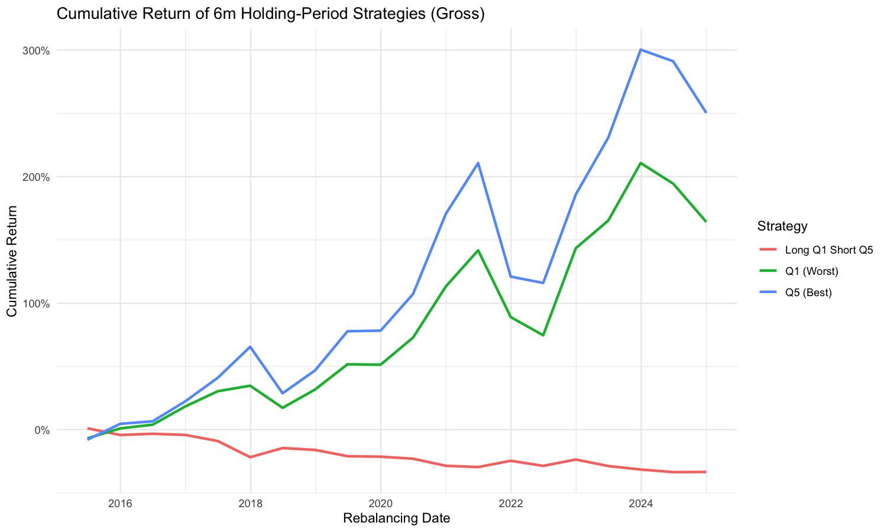
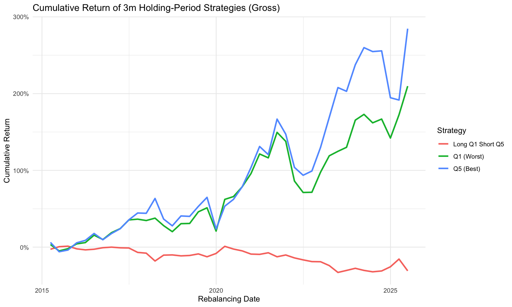

# 台灣股票型基金報酬反轉效應投資組合策略報告

> 完整、可重現的量化流程程式碼見 `R/` 與 `scripts/`。

## 一、研究目的與核心理念

本策略旨在驗證**基金經理人績效的反轉效應**是否存在於台灣共同基金市場中。核心想法是：追求相對報酬的基金經理人有一定的績效壓力需要達成——若前一段期間基金績效已頗高，經理人可能採取相對保守的操作；若前一段期間績效不佳，經理人則有動機更認真選股、加強市場研究。如此推論下，前期績效不佳之基金可能有較高的異常報酬。傳統金融文獻也指出，過去一段期間的績效可能無法持續，在短線（3–6 個月）上甚至可能呈現反轉。

本研究即以此觀點為核心理念，運用基金過去報酬（淨值變化率）建立五分位機制，Q1 為過去表現最差、Q5 為過去表現最好，並以此建構**反轉投組（Long Q1, Short Q5）**，以六個月、三個月持有期持有後再次排序、再平衡，最後進行回測績效比較與統計檢定，藉此評估此策略的有效性與穩健性。

## 二、資料來源

### 1. 基金淨值資料

來源：TEJ 台灣經濟新報資料庫（TEJ Pro Fund DB）國內投資股票型基金分類，資料區間 2015/01/30 – 2025/11/21。透過 TEJ 下載每月 NAV 報酬使用。篩選：去除 TISA 基金（有波動率限制），去除相同基金之 B 類（配息型）份額。總共 250 檔。

### 2. 無風險利率

無風險利率代理選用**商業本票次級市場利率**，而非銀行牌告的一年期定存利率：前者是可交易的貨幣市場利率，是台灣學界建構因子模型（如複製 Fama-French 三/五因子）的慣用無風險利率代理，對應美國文獻常用的 1-month T-bill；後者是銀行零售儲蓄利率，調整頻率低，與市場實際短期資金成本脫節，作為無風險利率代理較不嚴謹。

主要序列取自 TEJ（91–180 天期，series `MB04`，涵蓋至 2024/12），2025 年各月則以[中央銀行重要指標統計表](https://www.cbc.gov.tw/public/data/economic/statistics/key/interest.pdf)公開的 31–90 天期次級市場利率銜接——兩者在唯一重疊月份（2024/12）分別為 1.87% 與 1.75%，差距約 0.12 個百分點，屬正常的到期日利差，作為缺口月份的替代值合理。

以上資料為 TEJ 授權資料庫內容，依使用條款不可公開重新散布，因此本 repo **不含 TEJ 原始資料檔**，僅提供程式碼與彙總後的績效結果；央行公開利率資料則有隨附。詳見 [`data/README.md`](../data/README.md)。

### 3. 資料缺失值

為了避免資料缺漏對績效回測造成偏誤，處理資料上區分「選股階段的 NA」與「持有期間的 NA」，以持有期 6 個月為例：

- 在**選股階段**，如果某基金過去 6 個月資料不完整，直接不把它納入排序，避免用不完整的歷史評估經理人。
- 在**持有 6 個月的報酬計算**上，不能直接用 `na.rm=TRUE`，否則等於讓基金「瞬間跳過沒有資料的月份」，會放大持有期報酬。因此對沒有報酬資料的月份做無報酬假設，報酬率設為 0%。
- 同樣的邏輯也套用在持有期的另一端：若某次再平衡的持有窗口會延伸到資料涵蓋範圍之外（例如樣本最尾端、還沒有資料的月份），這次再平衡直接排除在回測外，而不是把「還沒發生」的月份也當成 0% 報酬計入——避免捏造尚未觀察到的資料點。

### 4. 樣本代表性：倖存者偏差檢查

共同基金研究常見的疑慮是：長期落後、後來被清算的基金若完全不在資料裡，會讓表現最差分位（Q1）的真實報酬被高估。為了確認這份資料的代表性，我們檢查每檔基金最後一筆非缺值報酬的日期（`R/data_prep.R::fund_exit_diagnostic()`）：215 檔有資料的基金中，**33 檔（約 15%）的報酬序列在樣本中途就結束、之後再也沒有出現**——多數從樣本第一天（2015-01-30）就有完整資料，卻在某個時間點後停止，最合理的解釋是清算或合併。這代表這些基金消失前的歷史報酬確實有被保留在資料裡、正常納入回測，樣本並非只收錄查詢當下仍存續的基金，倖存者偏差的疑慮因此較低。唯一無法排除的殘餘風險，是在樣本起點（2015-01-30）之前就已經消失、從未進入查詢範圍的基金，這較接近「樣本起始日的自然限制」，而非嚴格意義的倖存者偏差。

## 三、投組編制（以持有期 6 個月為例）

**過去 6 個月滾動報酬計算（Lookback Period）**：為排序基金績效，計算每檔基金在每個月底的過去 6 個月累積報酬，只有完整 6 個月資料的月份才計算，否則設為 NA。僅保留 6 月及 12 月作為再平衡點，確保有完整 lookback 資料。

**五分位分組（Quintile Ranking）**：在每個再平衡月份，根據過去 6 個月報酬將基金分為 5 組（quintile=1 為最差組，quintile=5 為最佳組）。

**持有期報酬計算（Holding Period Return）**：於再平衡日選定 Q1 及 Q5 基金後，計算未來 6 個月持有期報酬；模擬買進持有策略，每檔基金獨立計算 6 個月複利報酬後等權平均；缺月報酬補 0%（避免放大持有期報酬）。

**無前視偏誤（No Look-ahead）**：選股排名只使用「再平衡日當天或之前」的報酬，持有期報酬只使用「再平衡日之後」的報酬，兩者之間沒有重疊；再平衡與持有期報酬計算之間逐一核對過沒有未來資訊滲漏。

**交易成本**：每次再平衡兩腳位（Q1、Q5）都會全部換手，等於每期都要贖回舊基金、申購新基金一次。台灣國內股票型基金的申購手續費（前收型）牌告費率約 1.5%–3%，銀行等傳統通路折扣後常見 1%–2%，基富通等平台近年已把單筆申購手續費降到 0%；贖回費部分，前收型股票基金持有超過短期閉鎖期（通常 30–90 天）後免收，本研究最短持有期為 3 個月，遠超過此閉鎖期，故假設贖回免費、成本只發生在申購端。主結果採 **1% 單邊申購成本**（`net_ret = (1+gross_ret) x (1-1%) - 1`），代表一般會找折扣通路但非最低價的投資人；另附 0%/0.5%/2% 的敏感度結果供參考（見「四、績效表現」）。

## 四、績效表現

### 持有期 6 個月

從累積報酬曲線觀察：Q5 報酬曲線顯著高於 Q1，兩投組呈現同升同降，而 Long Q1 Short Q5 曲線整體呈下降趨勢。



| 策略 | Ann_Return | Ann_Vol | Ann_Rf | Ann_ExcessReturn | Sharpe_Ratio | t 統計量 | p 值 |
|---|---|---|---|---|---|---|---|
| Q1（最差） | 10.20% | 20.03% | 0.79% | 9.41% | 0.470 | — | — |
| Q5（最佳） | 13.36% | 23.04% | 0.79% | 12.57% | 0.546 | — | — |
| Q1-Q5 | -3.98% | 7.69% | 0.79% | -4.77% | -0.621 | -1.54 | 0.140 |

### 持有期 3 個月

與持有 6 個月大致相同：Q5 報酬曲線顯著高於 Q1，兩投組同升同降，Long Q1 Short Q5 曲線整體呈下降趨勢。



| 策略 | Ann_Return | Ann_Vol | Ann_Rf | Ann_ExcessReturn | Sharpe_Ratio | t 統計量 | p 值 |
|---|---|---|---|---|---|---|---|
| Q1（最差） | 11.37% | 19.87% | 0.80% | 10.57% | 0.532 | — | — |
| Q5（最佳） | 13.69% | 23.17% | 0.80% | 12.89% | 0.556 | — | — |
| Q1-Q5 | -3.46% | 11.42% | 0.80% | -4.25% | -0.372 | -0.81 | 0.423 |

### 兩種持有期比較

整體實證結果相同，Q5 皆勝出 Q1，以致 Long Q1 Short Q5 投組報酬均為負值。兩者比較下，持有期較短時 Q5 領先 Q1 更多，而整體 Sharpe 值則是持有期 6 個月更高。加入單樣本 t 檢定（`t.test(ls_ret, mu = 0)`，樣本點因再平衡頻率與持有期長度相同而不重疊，獨立性假設合理）後：兩個持有期的 p 值都遠大於 0.05，**Q1-Q5 的負報酬在統計上並不顯著**。

### 扣除交易成本後

以 1% 單邊申購成本計算（`output/tables/perf_table_{3m,6m}_net.csv`），並額外提供 0%/0.5%/2% 的敏感度結果（`output/tables/cost_sensitivity_{3m,6m}.csv`）：

| 6M 單邊成本 | Q1 Ann_Return | Q5 Ann_Return | Q1-Q5 Ann_Return |
|---|---|---|---|
| 0%（毛報酬） | 10.20% | 13.36% | -3.98% |
| 0.5% | 9.10% | 12.23% | -3.96% |
| 1%（主結果） | 8.01% | 11.10% | -3.94% |
| 2% | 5.84% | 8.87% | -3.90% |

Q1、Q5 兩腳位的絕對報酬隨成本假設明顯下降，但 **Q1-Q5 價差報酬幾乎不受影響**（成本在兩腳位裡大致抵銷），t 統計量也維持在 -1.54 左右——成本假設會實質影響「這個策略本身好不好」的判斷，但不太影響「反轉 vs. 動能」這個核心方向性結論。

## 五、實證結果

過去表現最差組的基金投資組合並未能勝過表現最好的：加入顯著性檢定後，兩個持有期下 Long Q1 Short Q5 的負報酬皆不顯著（p 值分別為 0.140、0.423），但方向一致，仍可以說在 3–6 個月持有期下，台灣的基金中，**動能因子較反轉因子更有效**——不只報酬較高，Sharpe 比率也較高，只是證據強度有限，樣本期間內尚不能完全排除純屬雜訊的可能性。

根據結果可以讓我們有不同觀點的啟發。從基金經理人角度來看，績效好的經理人可能較不會大幅度調整部位，可能捕捉更多動能因子、得到更多報酬，也會吸引更多新資金注入，推升績效；而績效差的經理人可能因贖回壓力被迫減碼，現金不足以支應贖回時將賣出持股，就算經理人認為該檔股票被低估，也無法持有到股價上升段，因此報酬較低。

## 六、投資組合在市場下跌時表現與避險投組（以績效較佳的 6 個月持有期為例）

使用 2020–2025 之台灣 50 指數月資料（報酬指數值）判斷月跌幅最高的月份，分別為：2020-03、2022-09、2024-11、2025-03。因投組策略為持有 6 個月，可知當時持有基金為以 2019-12-31 績效分組再平衡，其餘跌幅月份也雷同。

註：`crash_date` 為該年度跌幅最大的崩跌月份月末日期；`crash_ret` 為該月份的指數月報酬；`reb_for_crash` 為崩跌月份落入的 6 個月持有期所對應的再平衡日；`q1_6m_ret` 為 Q1（過去 6M 最差）投組在該持有期的未避險累積報酬。

| 崩盤月 | 市場單月報酬 | Q1 6M 報酬 | Q1 避險後 | Q5 6M 報酬 | Q5 避險後 | Q1-Q5 6M 報酬 | Q1-Q5 避險後 |
|---|---|---|---|---|---|---|---|
| 2020-03 | -13.54% | -0.20% | N/A* | 0.28% | N/A* | -0.49% | N/A* |
| 2022-09 | -12.43% | -7.59% | -5.52% | -2.26% | 2.01% | -5.34% | -7.19% |
| 2024-11 | -3.09% | -5.24% | -9.46% | -2.28% | -10.28% | -2.96% | 1.35% |
| 2025-03 | -10.40% | -10.29% | -10.92% | -10.43% | -11.62% | 0.14% | 0.79% |

\* 2020-03 台灣 50 指數沒能拿到更早之前的資料，無法求得該期市場報酬，因此無法估計 Beta 避險報酬率。

可以看出 Q1、Q5、Q1-Q5 投組皆可有效降低損失（比較 `crash_ret` 與 6M 報酬），也有正報酬出現。結果來說，這三個投資組合雖大多跟著市場下跌，但在報酬率上能擊敗市場單月跌幅。原因可能是持有期長達 6 個月，對市場單月大幅下跌的反應有限，能避掉短期波動；雖以單月跌幅與 6 個月持有期跌幅相比不太穩當，但可以說明策略本身能規避單月下跌的衝擊。

若能在股市崩跌前一期，採用台指期貨進行避險：先用迴歸估計投組的 6 個月持有期 Beta 係數（解釋變數為台灣 50 指數 6 個月報酬），再依據持有 Beta 比例的台灣 50 指數空單進行避險：

```
避險後報酬 = (1 + 未避險報酬) / (1 + β × 崩跌月市場報酬) - 1
```

估計出的 6 個月持有期 Beta 都偏低（Q1 ≈ 0.12、Q5 ≈ 0.22、Q1-Q5 ≈ -0.11），可發現避險後報酬並未顯著提高，有時甚至方向不一致（如 2024-11、2025-03 避險後虧損反而擴大）。原因可能是這三種投組的 Beta 值本來就偏低，可能投組真的與大盤連動性低，也可能是因為持有期太長，導致樣本點（每年僅 2 次再平衡）過小，估計不精確；低 Beta 使得空單部位的報酬佔整體報酬比重極少，避險效果因此不明顯。

## 七、結語與改進方向

本研究以 3 個月與 6 個月持有期比較基金報酬的動能與反轉效果，並加入顯著性檢定、交易成本與樣本代表性檢查。實證結果顯示：

- Q1（績效最弱）報酬持續落後 Q5（績效最強）；Q5 持續展現動能延續，在報酬與 Sharpe 上皆優於 Q1。
- Long Q1 Short Q5 反轉策略於兩個持有期皆為負報酬，但統計上不顯著（p 值 0.140、0.423），動能效果的證據強度有限。
- 加計 1% 單邊申購成本後，Q1、Q5 單腳位的絕對報酬明顯下降，但 Q1-Q5 價差報酬與其顯著性幾乎不受影響。
- 6 個月持有期表現整體優於 3 個月，雜訊較少、績效更穩定。
- 避險部分因台指資料不足、持有期過長導致樣本數偏低，β 估計不精準，避險效果不明顯。
- 樣本代表性檢查顯示清算/合併基金的歷史報酬有被保留在資料中，倖存者偏差的疑慮較低。

### 改善方向

- **加入 Q2, Q3, Q4 討論**：可觀察績效位於中間段的長期報酬。
- **補齊避險資料**：加入台指期、台股指數或 ETF，以改善 β 估計精度與避險成效。
- **完善缺漏資料處理**：基金無淨值可能因假日延後估值、資料延遲、基金暫停估值、T+1/T+2 結算等因素，本研究以 0% 報酬處理，未來可加入線性補值或同類型指數填補，降低資料缺漏造成的報酬扭曲。
- **擴大持有期測試**：加入 1M、9M、12M 等期間，更完整描繪動能與反轉的時間結構。
- **加入基金特徵變數**：如基金規模（AUM）、費用率、經理人任期、持股風格等，以增強模型的解釋力與穩健性。
